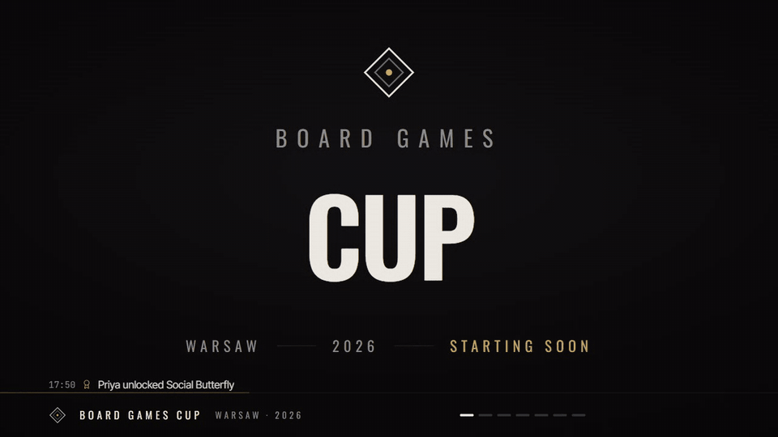
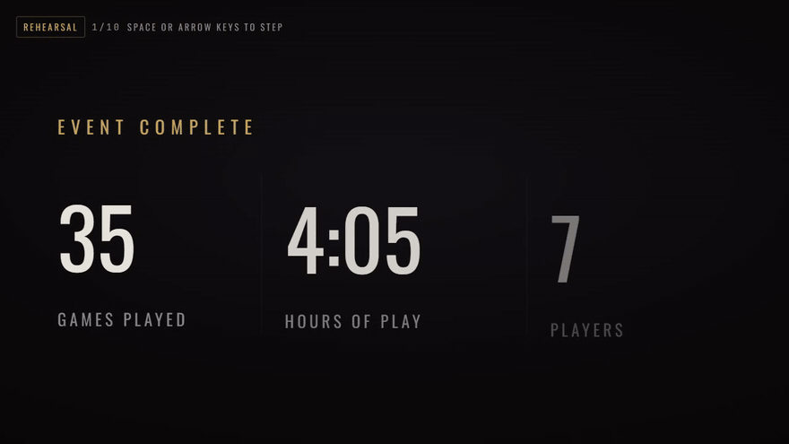

<div align="center">

# Board Games Cup

**A live tournament platform for a one-evening board game event.**

The organizer runs the tables from a phone, players follow along on their own phones, and a projector turns the room into a show that ends in a staged finale ceremony. Everything runs as one Node process with a local SQLite database.


</div>

## Contents

- [Features](#features)
- [Demo](#demo)
- [Tech stack](#tech-stack)
- [Getting started](#getting-started)
- [Deployment](#deployment)
- [Commands](#commands)
- [How it works](#how-it-works)
- [Customization](#customization)
- [Troubleshooting](#troubleshooting)
- [License](#license)

## Features

- **Control room for the organizer.** Seat players, start games, enter results, undo and redo, merge duplicate players and fix Joker declarations. It's designed for a phone, protected by a PIN, and every change is written to an audit log.
- **Standings stay secret until the end.** Phones and the projector only get data that's already visible in the room. Points and ranks never leave the server before the finale, and a test enforces this.
- **Projector mode.** A 1920×1080 stage with rotating scenes: live room, recent results, event stats, achievements, stories of the night, popular games and an optional contenders scene. Each result gets a reveal from last place up to the winner, and milestones and achievement unlocks get their own cards.
- **22 achievements**, recomputed from the results, so a corrected result also corrects them. Five are *sealed*: what they're for stays hidden until the finale.
- **Finale ceremony.** The organizer steps through it from a phone remote: the evening in numbers, sealed achievements, 3rd, 2nd, the champion and the final standings. You can rehearse it with placeholder data before the event.
- **Player profiles, stats and timeline.** Covers game popularity, the longest and fastest games, rivals, hot streaks and a heatmap of table hours.
- **Fair scoring.** Points depend on game weight and include a participation floor. Each player has one Joker for the evening, and the tournament score is either Best N results or Total.
- **Self check-in by QR**, with printable codes for the site, check-in, projector and admin.
- **English and Russian**, set separately for phones and the projector.
- **Works offline.** One process and one SQLite file, with automatic backups.

## Demo

All media below uses the built-in demo data (`npm run db:seed:demo`).

### Result reveal on the projector

Places are revealed from last to first, then the podium is shown.



### Finale ceremony

This is the rehearsal at `/screen?rehearsal=1`, shown at 1.5× speed.



### Phones and control room

| Home | Achievements | Stats |
|---|---|---|
|  |  |  |


## Tech stack

| Layer | Tools |
|---|---|
| App | Next.js 16 (App Router, server actions), React 19, TypeScript |
| UI | Tailwind CSS 4, Radix UI, Motion, lucide-react, dnd-kit |
| Data | SQLite (better-sqlite3), Drizzle ORM and drizzle-kit migrations |
| Tests | Vitest |

## Getting started

Requires Node.js 22 or later.

```bash
npm install
cp .env.example .env          # set ADMIN_PIN (4–8 digits)
npm run setup                 # create the database, games and tables
npm run db:seed:demo          # optional: 22 demo players and 15 results
npm run dev                   # http://localhost:3000
```

| URL | For |
|---|---|
| `/` | Participants: live room, recent results, check-in |
| `/checkin` | Self check-in |
| `/leaderboard` | Standings (sealed until the finale) |
| `/achievements` | Achievements, rarity and who unlocked them |
| `/players/<id>` | Player profile (standings appear after the finale) |
| `/stats` | Popularity, longest and fastest games, rivals, table-hour heatmap |
| `/timeline` | Everything that happened, newest first |
| `/screen` | Projector (always anonymous) |
| `/screen?rehearsal=1` | Finale rehearsal with placeholder names (`&lang=ru` for Russian) |
| `/admin` | Organizer control room (PIN) |
| `/admin/qr` | Printable QR codes |

## Deployment

**On a laptop at the venue (recommended):** run `npm run event`, which builds the app and starts the production server on port 3000. Phones need to be on the same network. In Admin → Settings → Network, choose the laptop's LAN address, then print QR codes from `/admin/qr`. Open `/screen` fullscreen on the projector.

**Hosted:** you need one long-running container with a persistent disk. Serverless platforms like Vercel won't work, because the SQLite file has to be shared by every request. On Railway:

1. Create a project from this repo. Nixpacks detects Node 22 and includes the build tools `better-sqlite3` needs.
2. Add a volume mounted at `/app/data`, which is the default database and backup location.
3. Set `ADMIN_PIN`. Railway sets `PORT`, and `npm run start` uses it.
4. Set the start command to `npm run setup && npm run start`. `setup` is idempotent.
5. After deploying, enter the public URL in Admin → Settings → Network so the QR codes point to it.

Fly.io works the same way: one machine plus a volume. Make sure the image has `python3 make g++` so `better-sqlite3` can compile.

## Commands

| Command | What it does |
|---|---|
| `npm run dev` | Development server on all interfaces |
| `npm run event` | Production build and start |
| `npm run setup` | Apply migrations and create base data (idempotent) |
| `npm run db:seed:demo` | Add demo players and results (flagged as demo) |
| `npm run db:clear-demo` | Remove demo data |
| `npm run db:reset` | Delete the database and recreate base data (stop the server first) |
| `npm run backup` | Copy the database to `data/backups/` (also automatic, at most every 5 min) |
| `npm run pin:reset` | Set the admin PIN from `ADMIN_PIN`, keeping all data |
| `npm test` / `npm run typecheck` / `npm run lint` | Tests, TypeScript, ESLint |

## How it works

### Architecture

```
src/domain      Pure TypeScript: scoring, replay, achievements, stats, snapshots. No React, no database.
src/server      SQLite via Drizzle, repositories, transactional services, auth, live cache.
src/app         Next.js pages, server actions, /api/live.
src/components  UI for admin, public pages, projector, and shared primitives.
src/i18n        English and Russian dictionaries.
```

- **The database stores facts only:** players, games, tables, sessions (one game at one table), placements, Joker declarations, announcements and the audit log.
- **Derived state is replayed.** Points, standings, achievements and stats are recomputed by replaying finished sessions in order (`src/domain/replay.ts`), cached per data version. That way, editing or undoing a result can never leave stale totals behind.
- **Live updates use polling.** Every mutation runs in a transaction and bumps `event.dataVersion`. Clients poll `/api/live?v=<version>` every 2 s and only receive a new snapshot when the version has changed.

### Scoring

For a game with weight `W`, `N` players and a participation floor `f` (default 20%):

```
share  = f + (1 − f) × (N − place) / (N − 1)
points = W × share
```

- Last place still earns `W × f`, so time spent at a long game is rewarded.
- Ties (only in games that allow them) use competition ranking (1, 1, 3), and tied players split the spanned places evenly.
- Each player has one Joker for the event. It's declared when they're seated and multiplies that game's points (default ×1.5).
- The tournament score is the Best N results (default 4) or the Total. Ranking order: counted points, then wins, then raw points, then fewer games played, then name.

### Privacy and the finale

The server builds two snapshots (`src/domain/snapshot.ts`). The **public** one, used by phones and `/screen`, has no points, ranks, games played or Joker status at all. The **admin** one has everything. `/screen` always uses the public snapshot, even in a browser where the admin is logged in.

The finale is driven from `/admin/finale` and steps through the evening in numbers, the sealed achievements, 3rd, 2nd, the champion, then the final standings. Only when the final-standings step is reached do the standings become public on every phone and on `/leaderboard`. Before that, the public data for each step contains only player ids, so the podium can't leak early.

## Customization

| What | Where |
|---|---|
| Games: weights, player counts, ties | Admin → Games; defaults in `src/server/seed/base.ts` |
| Scoring: strategy, N, floor, Joker multiplier | Admin → Settings → Scoring |
| Projector scenes, duration, language | Admin → Settings → Projector |
| Event name, city, year, accent color | Admin → Settings → Event |
| Achievements on/off, sealed | Admin → Achievements; rules in `src/domain/achievements.ts` |
| Colors and fonts | `src/app/globals.css` (`@theme`), `src/app/layout.tsx` |
| Text | `src/i18n/en.ts`, `src/i18n/ru.ts` |

## Troubleshooting

- **Phones can't connect:** this is usually a firewall, a network profile set to Public, the wrong address chosen in Settings, or venue Wi-Fi that isolates clients (use a hotspot instead). On Windows, `scripts/windows-firewall.ps1` opens port 3000.
- **`db:reset` fails because the file is locked:** stop the server first.
- **Forgot the PIN:** set `ADMIN_PIN` in `.env` and run `npm run pin:reset`. Event data is kept.
- **Port 3000 is busy:** run `npx next start -H 0.0.0.0 -p 3001`, then choose the matching address in Settings.

## License

[MIT](LICENSE) © 2026 Andrii Sonsiadlo
