<div align="center">

# Board Games Cup

**A live tournament platform for a one-evening board game event.**

The organizer runs tables from a phone, players follow along on theirs, and a projector turns the room into a show, ending with a staged finale ceremony. It runs on one laptop with a local SQLite database.

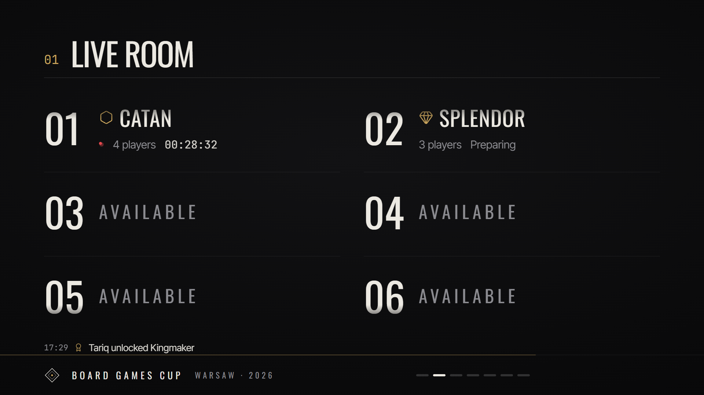

</div>

## Contents

- [Features](#features)
- [Screenshots](#screenshots)
- [Tech stack](#tech-stack)
- [Quick start](#quick-start)
- [Event night on Windows](#event-night-on-windows)
- [Hosted deployment](#hosted-deployment-for-one-evening-not-vercel)
- [Commands](#commands)
- [How it works](#architecture)
- [Customization](#where-to-change-things)
- [Troubleshooting](#troubleshooting)

## Features

- **Control room for the organizer.** Seat players, start games, enter results, undo and redo, merge duplicate players and fix Joker declarations. It's built for a phone and protected by a PIN, and every change goes into the audit log.
- **Standings stay secret until the end.** Phones and the projector only receive data that's public in the room. Points and ranks never leave the server before the finale, and a test enforces this.
- **Projector mode.** A 1920×1080 stage with rotating scenes: live room, recent results, event stats, achievements, stories of the night, popular games and an optional contenders scene. Results get a reveal from last place up to the winner, and milestones and achievement unlocks get their own cards.
- **22 achievements**, recomputed from results, so a corrected result also corrects them. Five are *sealed*: their meaning stays hidden until the finale.
- **Finale ceremony.** The organizer steps through the beats from a phone remote: event in numbers, sealed achievements, 3rd, 2nd, champion, then the final standings. You can rehearse it with placeholder data at `/screen?rehearsal=1`.
- **Player profiles, stats and timeline.** Covers game popularity, the longest and fastest games, rivals, hot streaks and a heatmap of table hours.
- **Fair scoring.** Points depend on game weight and include a participation floor. Each player has one Joker for the evening, and the tournament score is either Best N results or Total.
- **Self check-in by QR**, with printable QR codes for the site, check-in, projector and admin.
- **English and Russian**, set separately for phones and the projector.
- **Works offline.** One Node process and one SQLite file, with automatic backups.

## Screenshots

### Projector (`/screen`)

| Recent results | Achievements |
|---|---|
| 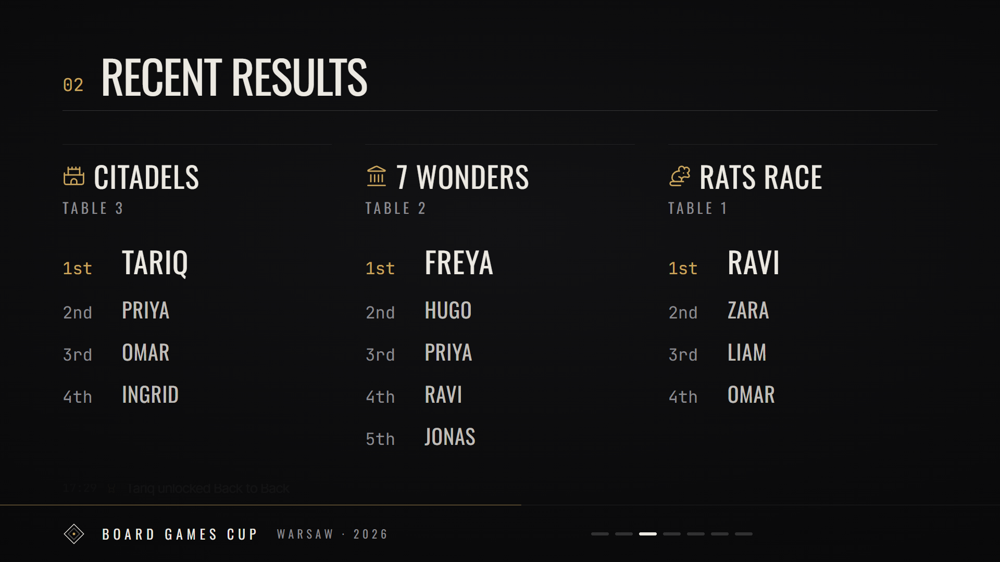 | 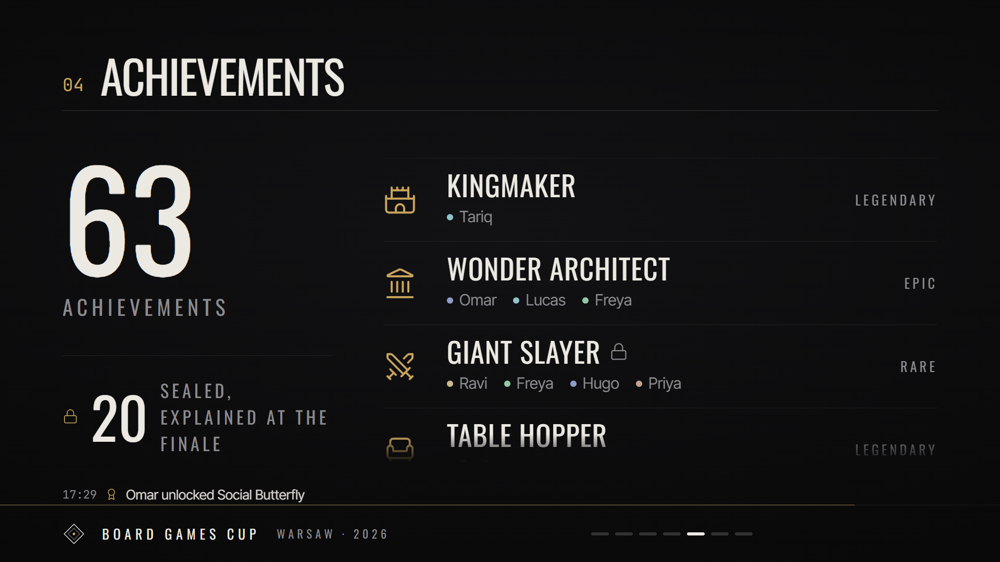 |
| **Stories of the night** | **Title** |
| 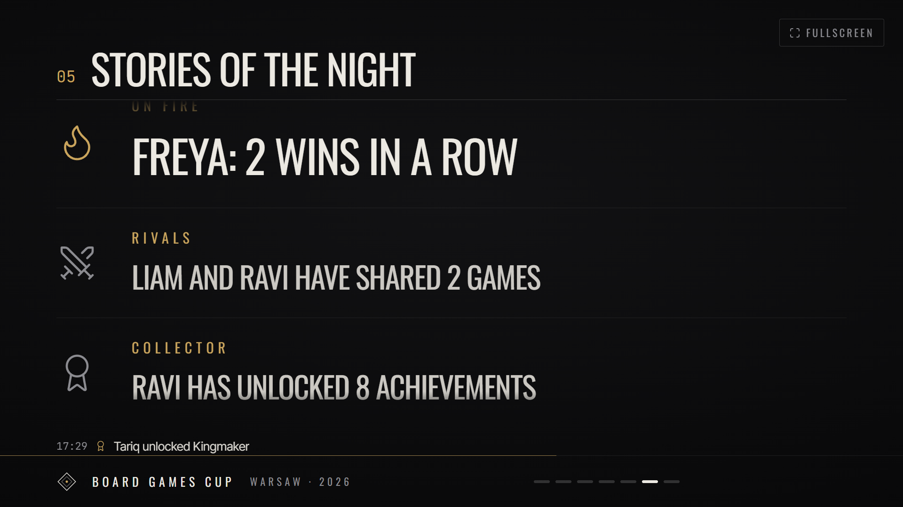 | 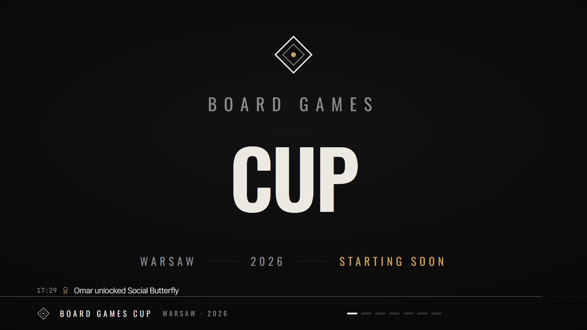 |

### Finale ceremony

| Sealed achievement | Podium | Final standings |
|---|---|---|
| 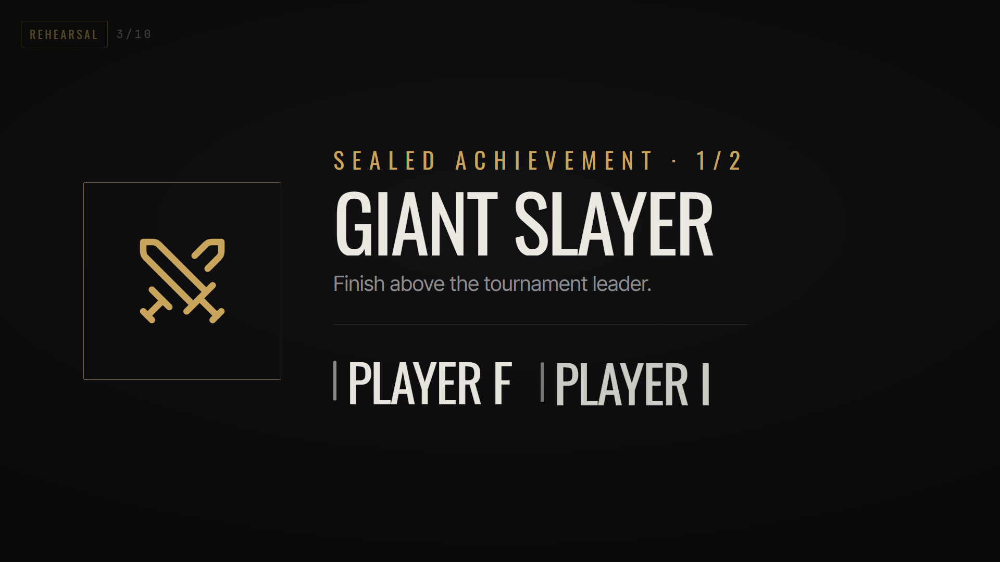 | 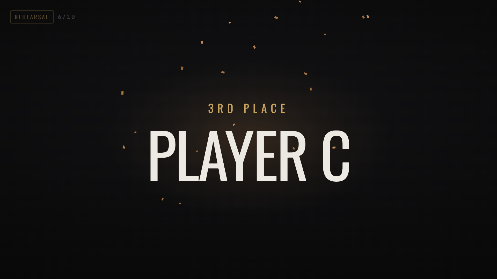 | 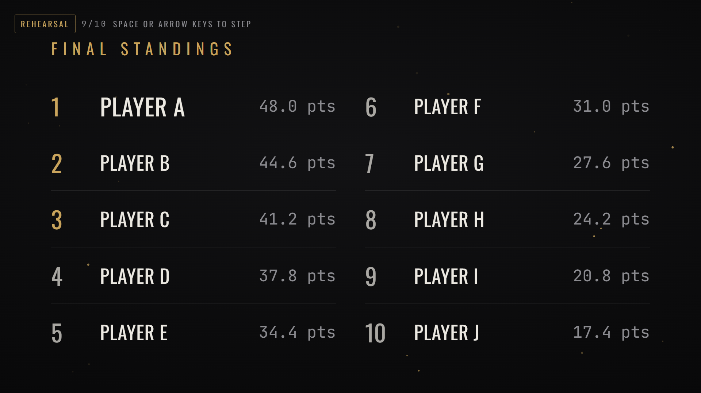 |

### Phones (participants)

| Home | Achievements | Stats | Timeline |
|---|---|---|---|
| 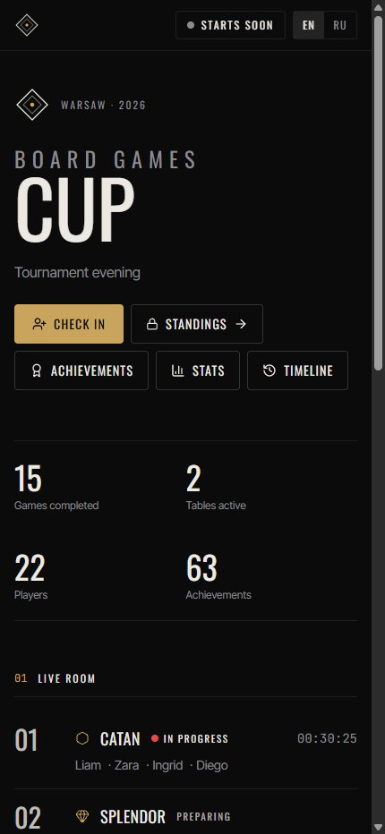 | 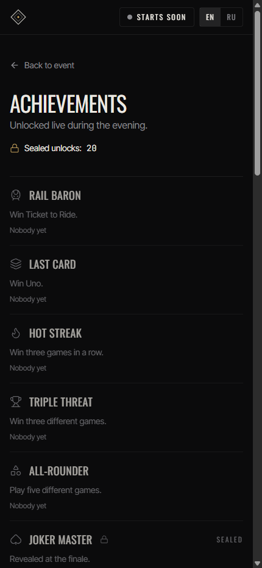 | 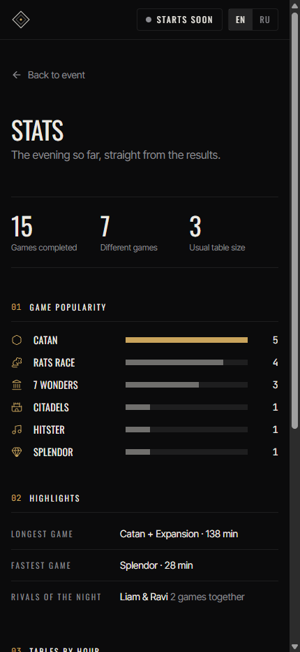 | 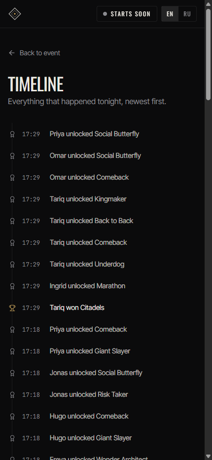 |

### Organizer (`/admin`)

| Control room | Standings | Achievements |
|---|---|---|
| 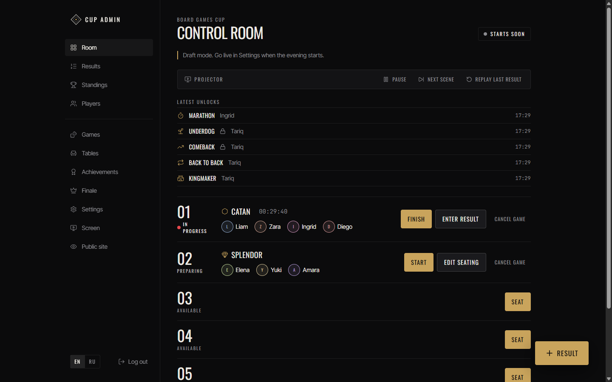 | 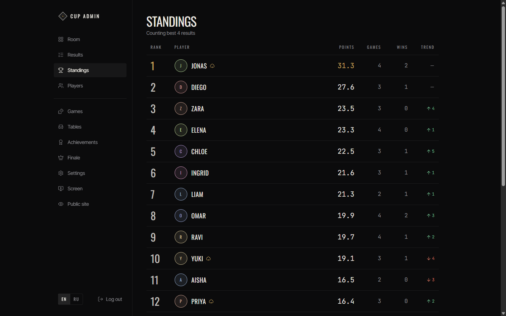 | 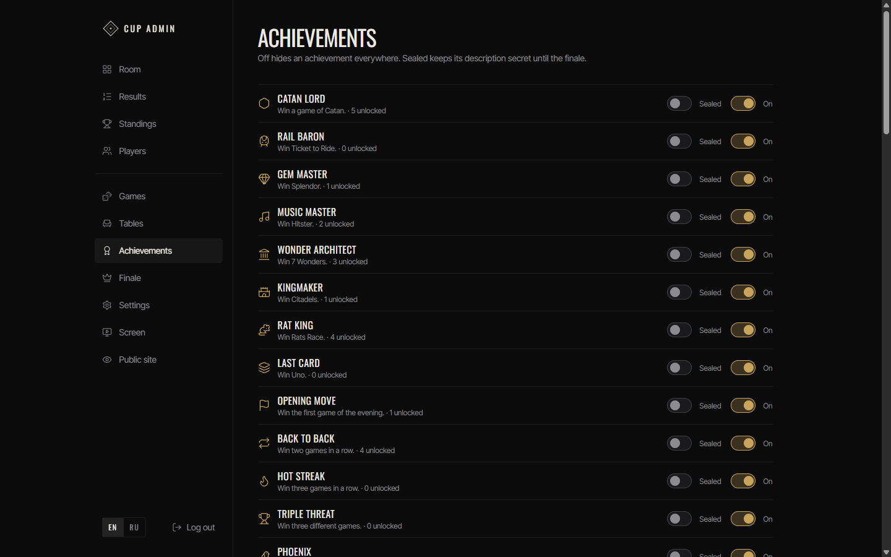 |

*Screenshots use the built-in demo data (`npm run db:seed:demo`).*

## Tech stack

| Layer | Tools |
|---|---|
| App | Next.js 16 (App Router, server actions), React 19, TypeScript |
| UI | Tailwind CSS 4, Radix UI, Motion, lucide-react, dnd-kit |
| Data | SQLite (better-sqlite3) via Drizzle ORM and drizzle-kit migrations |
| Tests | Vitest |

## Quick start

Requires Node.js 22 or later.

```bash
npm install
cp .env.example .env          # set ADMIN_PIN
npm run setup                 # create database, games, tables
npm run db:seed:demo          # optional: 22 demo players and 15 results
npm run dev                   # http://localhost:3000
```

| URL | Who |
|---|---|
| `/` | Participants: live room, recent results, check-in |
| `/checkin` | Self check-in |
| `/leaderboard` | Sealed until the finale |
| `/achievements` | Achievements, rarity and who unlocked them |
| `/players/<id>` | Player profile; standings part appears after the finale |
| `/stats` | Game popularity, longest and fastest games, rivals, table-hour heatmap; finale stats after the reveal |
| `/timeline` | Everything that happened, newest first |
| `/screen` | Projector (always anonymous) |
| `/screen?rehearsal=1` | Finale rehearsal with placeholder names (add `&lang=ru` for Russian) |
| `/admin` | Organizer (PIN) |
| `/admin/qr` | Printable QR codes (Settings → Network) |

## Event night on Windows

1. Install Node.js 22 LTS on Windows.
2. Copy the project to a Windows folder such as `C:\board-cup` (not a `\\wsl$` path).
3. In that folder:
   ```bat
   npm ci
   copy .env.example .env
   notepad .env
   npm run setup
   npm run event
   ```
   `npm run event` builds once and starts the production server on port 3000. The build downloads fonts, so run it while online.
4. Allow inbound connections: run `scripts\windows-firewall.ps1` in an elevated PowerShell, and set the Wi-Fi network profile to Private.
5. Open `http://localhost:3000/admin`, log in, go to Settings → Network and press Use next to the Wi-Fi address (for example `http://192.168.100.7:3000`). Ignore VPN or `vEthernet` addresses, then Settings → Network → Print QR codes.
6. From a phone on the same Wi-Fi, open that address. If it does not load, the venue Wi-Fi probably isolates clients: turn on Windows Mobile Hotspot and connect phones to it.
7. Projector: connect via HDMI as an extended display, open `http://localhost:3000/screen` in Chrome, press Fullscreen (or run Chrome with `--kiosk`).
8. Disable sleep on the laptop and keep it plugged in.
9. In Settings, remove demo data and press Go live when the evening starts.

Backups are written automatically to `data/backups/` at most every 5 minutes after changes. `npm run backup` takes one on demand.

## Hosted deployment for one evening (not Vercel)

This app is one long-running Node process writing to a local SQLite file (`data/board-cup.db`), with facts polled by phones every 2 s. **Vercel's serverless functions don't fit that shape**: their filesystem is read-only outside `/tmp`, `/tmp` isn't shared between instances or invocations, and a live event needs every visitor reading and writing the same data. Use a host that gives you one persistent container plus a persistent disk instead — Railway is the simplest:

1. Push this repo to GitHub and create a Railway project from it (Node 22 is auto-detected via Nixpacks; no Dockerfile needed — it also has the build tools `better-sqlite3` needs to compile).
2. Add a Volume mounted at `/app/data`. That's the app's default database and backup location (`DB_PATH` unset), so nothing else has to point at it.
3. Set the `ADMIN_PIN` environment variable. Railway injects `PORT` automatically and `npm run start` honors it.
4. Set the start command to `npm run setup && npm run start` so the database is migrated/seeded on first boot — `npm run setup` is idempotent, so it's safe to run on every restart too.
5. Deploy. Railway gives you a public HTTPS URL — open `/admin`, log in, go to Settings → Network, paste that URL into the custom address field and save, then print codes from `/admin/qr`.
6. Run one-off commands (`npm run db:seed:demo`, `npm run db:clear-demo`, `npm run backup`, `npm run pin:reset`) against the same volume via `railway run <command>` from your machine, or Railway's web shell.

Fly.io works the same way (one machine + a persistent volume) if you'd rather use it; `fly launch` generates a Dockerfile for a Next.js app automatically — just confirm the image installs `python3 make g++` (or uses a base image that already has them) since `better-sqlite3` needs to compile a native module during `npm install`.

## Commands

| Command | What it does |
|---|---|
| `npm run dev` | Development server on all interfaces |
| `npm run event` | Production build + start (use on event night) |
| `npm run setup` | Apply migrations and create base data (idempotent) |
| `npm run db:seed:demo` | Add demo players and results (marked as demo) |
| `npm run db:clear-demo` | Remove demo data |
| `npm run db:reset` | Delete the database and recreate base data (stop the server first) |
| `npm run backup` | Copy the database to `data/backups/` |
| `npm run pin:reset` | Set the admin PIN from `ADMIN_PIN` in `.env`, keeping all data |
| `npm test` | Unit and service tests |
| `npm run typecheck` | TypeScript check |
| `npm run lint` | ESLint |

## Architecture

```
src/domain     Pure TypeScript: scoring, standings replay, table state, snapshots. No React, no database.
src/server     SQLite (Drizzle), repositories, services (validated transactional mutations), auth, live cache.
src/app        Next.js App Router pages, server actions, /api/live.
src/components UI: admin, public, screen, shared primitives.
src/i18n       English and Russian dictionaries.
```

- The database stores facts only: players, games, tables, sessions (a game at a table), placements, Joker declarations, announcements, audit log.
- Points, standings, trends and counters are recomputed by replaying finished sessions in time order (`src/domain/replay.ts`) and cached per data version. Editing, deleting or undoing a result can never leave stale totals.
- Every mutation runs in a transaction and increments `event.dataVersion`. Clients poll `/api/live?v=<version>` every 2 s and receive a new snapshot only when the version changed.
- To move to PostgreSQL, replace `src/server/db` and `src/server/repo` with a Postgres Drizzle schema; services and domain stay unchanged.

## Database model

| Table | Purpose |
|---|---|
| `event` | Single row: name, status (draft/live/finished), scoring and screen settings, PIN hash, data version |
| `players` | Name, nickname, color, source (admin/check-in), active, demo flag |
| `games` | Name, family, icon, weight, min/max players, ties allowed, active |
| `tables` | Number, label, active |
| `sessions` | One game at one table: status setup → playing → pending → done (or cancelled), timestamps |
| `session_players` | Seat order, Joker declared, placement |
| `announcements` | Queue for the projector (result reveals, achievement unlocks, milestones) |
| `achievement_settings` | Achievements switched off by the organizer (missing row = enabled) |
| `audit_log` | Result create/update/delete, Joker corrections, merges, undo (with before/after JSON) |

## Scoring

For a game with weight `W`, `N` players and participation floor `f` (default 20%):

```
share = f + (1 − f) × (N − place) / (N − 1)
points = W × share
```

- Last place earns `W × f`, so time spent at a long game is rewarded.
- Ties (only for games that allow them) use competition ranking (1, 1, 3); tied players share the average of the spanned places.
- Joker: one per player for the whole event, declared when the table is seated and locked at start; multiplies that game's points (default ×1.5). Changes after start go through "Change Joker" and the audit log.
- Tournament score: Best N results (default N = 4) or Total. Raw points, counted points and excluded results are tracked.
- Ranking: counted points, then wins, then raw points, then fewer games, then name.
- Trend: rank before the player's latest result minus current rank.

Code: `src/domain/scoring.ts`, `src/domain/standings.ts`, `src/domain/replay.ts`. Tests: `npm test`.

## Anonymous mode

Standings are secret until the finale. The server builds two different snapshots (`src/domain/snapshot.ts`):

- Public (phones, `/screen`): tables, players at tables, placements of finished games, counters. Points, ranks, games played and Joker status are not included in the data at all.
- Admin: everything.

`/screen` always requests the public snapshot, even in a browser logged in as admin. A unit test asserts no forbidden fields exist in the public snapshot. Optional exceptions, both controlled in Settings: per-game points inside a result reveal, and the Contenders scene (top five in alphabetical order, no ranks).

Achievements are recomputed from results like points, so a correction or undo also corrects them. Public achievements are announced on the projector a few seconds after a result (after its reveal, if you press "Show on screen"). Five achievements are sealed (Comeback, Underdog, Giant Slayer, Joker Master, Risk Taker): their unlocks are announced like any other, but what they are for stays hidden until the finale, where each gets its own beat. Stats, stories, the timeline and hot-streak markers only use facts visible in the room; biggest comeback, best Joker, most games played and the rank race stay hidden until the finale.

## Projector mode

`/screen` renders a fixed 1920×1080 stage scaled to any display. Scenes rotate (Title, Live room, Recent results, Event stats, Achievements, Stories, Popular games, optional Contenders) with a configurable duration. A ticker above the footer cycles through the latest timeline items. The control room's Projector bar pauses, resumes or skips scenes and replays the last result. "Show on screen" after a result queues a reveal: game title, places from last to second, then the winner, then a podium hold. Milestones play at 10, 25, 50, 75 and 100 games. Achievement unlocks play as their own cards a few seconds later, holding back until any reveal of the same game has played first.

## Finale

1. Close all tables, then Settings → Finish event → Open finale remote (`/admin/finale`).
2. Each Next advances the projector: event complete, the evening in numbers, sealed achievements one by one, 3rd place, 2nd place, champion (co-champions when counted points, wins and raw points are equal), final standings, closing card.
3. The final standings step makes standings public on every phone and `/leaderboard`. The "Standings public" switch can undo or force that.
4. Auto-advance moves every 10 s. "Back to scenes" returns the projector to rotation.
5. Rehearse beforehand at `/screen?rehearsal=1` (Space or arrow keys); it never touches real data. Reopening the event resets the finale.

## Where to change things

| What | Where |
|---|---|
| Game weights, player counts, ties, active games | Admin → Games (live), defaults in `src/server/seed/base.ts` |
| Scoring strategy, N, participation floor, Joker multiplier | Admin → Settings → Scoring, defaults in `src/server/db/schema.ts` |
| Scene selection, duration, screen language, points in reveals | Admin → Settings → Projector |
| Event name, city, year, accent color | Admin → Settings → Event |
| Colors, radii, fonts | `src/app/globals.css` (`@theme` tokens), fonts in `src/app/layout.tsx` |
| Text (English/Russian) | `src/i18n/en.ts`, `src/i18n/ru.ts` |
| Achievement on/off | Admin → Achievements; rules in `src/domain/achievements.ts` |

## Troubleshooting

- Phones cannot connect: firewall rule missing, Wi-Fi profile is Public, wrong address selected in Settings, or client isolation on the venue Wi-Fi (use Mobile Hotspot).
- `npm run db:reset` fails with a locked file: stop the server first.
- Forgot the PIN: set `ADMIN_PIN` in `.env` and run `npm run pin:reset` (event data is kept).
- Port 3000 busy: `npx next start -H 0.0.0.0 -p 3001` and select the matching address in Settings.
- Demo announcements or milestones reappear after going live: they are removed together with demo data; if a result was entered on demo players by hand, clear demo data again from Settings → Data.

## Out of scope

Sound effects, in-game raw scores, player accounts and websockets (clients poll every 2 s).
